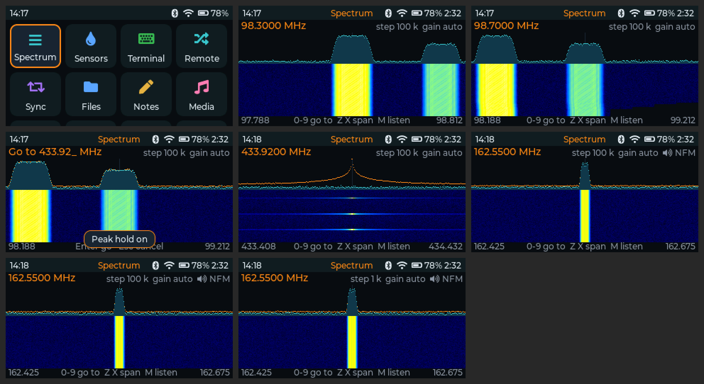

# cardputer-zero-rf

The RF apps for ZeroOS on the M5Stack Cardputer Zero, built around a USB software-defined radio
dongle (RTL-SDR Blog V4 first, others later). On ZeroOS they are one app, **RF Tools**, that you
install from the **Apps** app: it adds nine apps to the home screen and the radio programs they
drive, and removing it takes them away again. There is no separate RF image any more.



*Rendered from the real UI code at 320x170 against a simulated radio, shown at 2x.*

| Part | Status |
| --- | --- |
| `rf/` radio core: receiver backends, spectrum, FM and AM demodulation, the radio daemon `zrfd` and its protocol | Working against a simulated receiver and recorded files. Never run on a real dongle; audio checked by measurement, never by ear. |
| `shell/` the RF apps: **Spectrum**, **Scanner**, **Sensors**, **Aircraft**, **APRS**, **FT8**, **Logbook**, **SDR Server**, **Station**. On the device one module, `rf.so`, for ZeroOS's home screen | Working in the simulator and headless builds, and loaded as a module there; builds for arm64. Never run on a device. |
| `app/` the RF Tools package for ZeroOS's Apps app (`zeroos-app-rf`) and its `zeroos-apps.index` | Built in CI; a release publishes them. Never installed on a device. |
| `device/` the first-run check, dongle rules, and a kit for M5's stock image | Dry-run against the simulated radio only. See [docs/BRINGUP.md](docs/BRINGUP.md). |
| `base/` the base OS, [cardputer-zero](https://github.com/hartj77-blip/cardputer-zero), pinned as a submodule | Unchanged; we build on it, we don't fork it |

## Spectrum

Left/Right tune by one step, Up/Down change the step size, **Z**/**X** narrow or widen the view,
**G** cycles gain, **P** toggles peak hold, **C** centres on the strongest signal. Type a frequency
in MHz and press **Enter** to jump to it, or press **B** for a list of bands.

**M** cycles listening: off, broadcast FM, narrow FM, AM, upper and lower sideband, CW. The first
press picks the mode that suits the frequency: the right sideband on an amateur band, CW at the
bottom of one, AM on the airband. The bottom line names the band you are in and, while listening,
shows signal strength above the noise. **S** toggles squelch. **R** records raw IQ
to `~/Recordings` (about 2 MB a second at the default width; it stops by itself before the card
fills, and when you retune). Audio and recording stop when you leave the app.

**A** saves the channel you are on (type a name, **Enter**); **L** lists your saved channels, where
**Enter** tunes to one and **D** deletes it. They live in `~/.config/zeroos/rf-memories.tsv`, one
line each, and the Scanner can scan them.

**K** makes the radio keep playing after you leave Spectrum, so you can listen while writing notes
or browsing files. Opening Spectrum again picks the audio back up; opening another RF app stops it,
because that app needs the receiver. Spectrum reopens where you left it (frequency, width, step,
gain and squelch). **H** shows all the keys.

On broadcast FM the bottom line shows the station's name and text (from RDS) and whether it is in
stereo; headphones get both channels. **W** records what you are hearing to a WAV file in
`~/Recordings`, which the Media app plays and Sync copies off the device. With squelch on, only the
moments with a signal are recorded.

**F** follows a transceiver's dial through Hamlib, so the display becomes a panadapter for the
rig, and **T** sends the displayed frequency to the rig. Set the rig up in Station.

## Station

Your callsign and grid locator, the dongle's frequency correction (ppm), antenna power (bias tee),
the APRS frequency, and the rig for Hamlib (model number, serial port, speed). Enter edits a
field, Enter again saves it, Esc cancels. See [docs/HAM.md](docs/HAM.md).

## APRS

Amateur packet stations on 144.390 MHz (**F** steps through other regions' frequencies and the
ISS): one row per station with distance and direction from your grid, and what it last sent.
**Enter** shows the packet. Uses `rtl_fm` and `multimon-ng`.

## FT8

The weak-signal digital mode. Every 15 seconds the stations heard on the band's FT8 frequency are
listed with signal-to-noise ratio, audio frequency and message. Stations calling CQ are
highlighted, a message that mentions your callsign more so, and a grid in a message becomes a
distance from yours. **Left**/**Right** change band (160 m to 2 m), **Up**/**Down** scroll back.
Receive only. The device's clock must be right to within about a second. Decoding is by
[ft8_lib](https://github.com/kgoba/ft8_lib); see [docs/THIRD_PARTY.md](docs/THIRD_PARTY.md).

## Logbook

Amateur radio contacts, kept as ADIF in `~/Documents/logbook.adi`, which every logging program,
Logbook of the World, QRZ and eQSL can import (and which Sync copies off the device). **N** starts
a contact with the frequency and mode Spectrum is on, the customary report (59, or 599 for CW) and
the time in UTC; typing a callsign you have logged before says so. **Enter** on a contact shows
it, and **D** there deletes it.

## Scanner

Sweeps a band, stops on the first channel with a signal, plays it until it goes quiet, then carries
on, keeping a log of what it heard. **Left**/**Right** change band (airband, weather radio, marine,
amateur, FRS/GMRS, PMR446, CB, broadcast FM) and, last in the list, **Saved channels**, which
checks each channel you saved in Spectrum in turn, **Space** skips the current channel, **H** holds on
it, **L** locks it out, **C** clears the log and lockouts.

## Aircraft

ADS-B reports from aircraft overhead on 1090 MHz: flight, altitude, speed, heading with a climb
or descent arrow, and position. Decoding is our own, from the raw frames `rtl_adsb` prints, or
`dump1090-mutability` when that is installed (it hears more).

## SDR Server

Lends the dongle to an SDR program on another computer or phone (SDR++, GQRX, SDR#) over Wi-Fi or
Tailscale, using `rtl_tcp` on port 1234. The screen shows the address to enter. While it is on,
anyone on the same network can tune the radio; it stops when you leave the app.

## Sensors

Wireless weather stations, tyre sensors, doorbells and remotes, decoded by
[rtl_433](https://github.com/merbanan/rtl_433). One row per device with its latest readings.
**Enter** shows everything the selected device sent, **F** changes band (433.92, 315, 868.3,
915 MHz), **C** clears the list. Readings are metric for now.

## On the device

On **ZeroOS**, open **Apps**, pick **RF Tools** and press **Install**. It comes from this
repository's newest release (tag a version, `v0.1.0`, and the **Release** workflow publishes it).
Until there is a release, take `zeroos-app-rf_*.deb` from the *RF app and device kit* CI job and
run `sudo zeroos-apps install-file zeroos-app-rf_*.deb` on the device. Then plug in the dongle and
run `zeroos-rf-bringup` ([docs/BRINGUP.md](docs/BRINGUP.md)).

The package has to be built on **Debian trixie**, the system the device runs. Debian and Ubuntu
ship the RTL-SDR library under different names (`librtlsdr.so.0` and `librtlsdr.so.2`), so a
radio program built on Ubuntu will not start on the device. CI builds in a `debian:trixie` arm64
container, and `app/build.sh` refuses a program linked to the wrong one. To build it yourself on
an arm64 machine or under emulation:

```sh
docker run --rm --platform linux/arm64 -v "$PWD":/src -w /src debian:trixie sh -c '
  apt-get update && apt-get install -y git cmake g++ pkg-config librtlsdr-dev binutils dpkg-dev &&
  cmake -S shell -B build/device -DZS_BACKEND=device && cmake --build build/device -j &&
  app/build.sh build/device build/app'
```

The package must be built against a `base/` pin with the same app ABI (`ZS_APP_ABI` in
`base/shell/src/ui/app.h`) as the ZeroOS on the device; otherwise the Apps app doesn't offer it.

**On M5Stack's stock image** (the only system known to boot so far), the kit from the same CI job
installs a home screen with every app built in next to M5's launcher; see
[docs/FLASHING.md](docs/FLASHING.md). On ZeroOS the kit refuses and points you to the Apps app.

## Build and try on a PC

```sh
git submodule update --init base             # needs access to the base repository
sudo apt install cmake g++ pkg-config libsdl2-dev librtlsdr-dev
cmake -S shell -B build/sim -DZS_BACKEND=sim
cmake --build build/sim -j
ZRFD_BIN=$PWD/build/sim/rf/zrfd ./build/sim/zeroshell
```

With no dongle support built in or no dongle wanted, the PC build uses the simulated radio. Set
`ZRF_SOURCE=rtlsdr` to use a real dongle, or `ZRF_SOURCE=file:capture.u8` to replay a recording.

Render the RF screens to PNG (what CI does):

```sh
cmake -S shell -B build/headless -DZS_BACKEND=headless && cmake --build build/headless -j
shell/tools/screenshots.sh build/headless build/screenshots
```

## CI and the base

CI fetches the base submodule. If the base repository is ever private again, add a repository
secret named `BASE_REPO_TOKEN` holding a fine-grained token with read-only Contents access to
`cardputer-zero`; without it the RF shell and app jobs skip. The radio core job needs no token.

The device job also tests the RF apps the way the Cardputer runs them: the device build of the
home screen, with a fake screen and keyboard, opens each of the nine apps, presses keys and goes
back (once with simulated radio, once with no dongle). Then it installs the RF Tools package with
the real `apt` on Debian trixie arm64 and removes it again. Both tests live in the base
(`base/shell/tests/device/apps_test.py`, `base/image/tests/apps-install-test.sh`).

## Docs

- [docs/PLAN.md](docs/PLAN.md): the architecture, the power, CPU and memory budget, the app list
  and the phases.
- [docs/FLASHING.md](docs/FLASHING.md): flashing the OS to an SD card, installing RF Tools or the kit.
- [docs/BRINGUP.md](docs/BRINGUP.md): first run on a real device, and what to send back.
- [docs/HAM.md](docs/HAM.md): for amateur radio operators: bands, modes, rig control, what's missing.
- [docs/THIRD_PARTY.md](docs/THIRD_PARTY.md): other people's code we build in, and its licences.
- [rf/README.md](rf/README.md): the radio core and the daemon's protocol.

## License

MIT, see [LICENSE](LICENSE). Code from other projects keeps its own licence, listed in [docs/THIRD_PARTY.md](docs/THIRD_PARTY.md).
