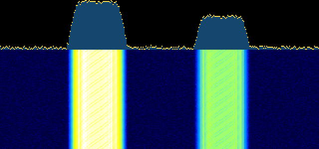

# rf: the radio core

The part of ZeroOS RF that talks to the receiver. It has no screen code and does not depend on
the base OS, so it builds and runs on any Linux PC.

| Piece | What |
| --- | --- |
| `zrfd` | The radio daemon. The one process that owns the receiver. Tunes it, computes the spectrum and serves clients over a Unix socket. |
| `zrf` | A command-line client for scripts, tests and trying things out. |
| `src/sdr/` | Receiver backends: `sim` (generated signals), `file:<path>` (IQ recording playback), `rtlsdr` (a real dongle). |
| `src/dsp/` | FFT and power spectrum; demodulators for broadcast FM, narrow FM, AM and single sideband. |
| `src/adsb.*` | Aircraft (ADS-B) frame decoding. |
| `src/aprs.*` | APRS packet reading, grid locators, distance and bearing. |
| `src/client.*` | The small client library the on-screen apps use. |



*Two simulated FM stations at 320 columns, shown at 2x: spectrum trace above, waterfall below.*

## Status

- Working and tested: the simulated and file sources, the spectrum, demodulation (each simulated
  signal decodes to the tone it carries), the daemon, the client.
- Written but **never run on a real dongle**: the `rtlsdr` backend. It compiles in CI against
  librtlsdr; that is all.
- **Never heard by a person**: audio is checked by measurement only. The default player command
  has not been tried on the device.
- Sensor, aircraft and APRS decoding are tested with stand-ins (`zrf-sim-sensors`,
  `zrf-sim-aircraft`, `zrf-sim-aprs`). The real rtl_433 has only been checked to accept our
  command line; rtl_adsb, dump1090, rtl_fm, multimon-ng and rtl_tcp have not been run at all. APRS
  packet reading is checked against the examples in the APRS specification. The aircraft decoder itself is checked against published
  reference frames.
- Not started: stereo and RDS, ship decoding, digital modes such as FT8. Pager decoding is left
  out on purpose: pager messages are other people's private communications.

## Build and try

```sh
sudo apt install cmake g++ librtlsdr-dev     # librtlsdr-dev is optional: without it, no dongle support
cmake -S rf -B build/rf
cmake --build build/rf -j
ctest --test-dir build/rf --output-on-failure
```

```sh
./build/rf/zrfd --source sim &               # or: --source rtlsdr, --source file:capture.u8
./build/rf/zrf send tune 98300000            # Hz
./build/rf/zrf watch                         # live spectrum as text; Ctrl-C to stop
./build/rf/zrf snapshot fm.ppm 320 100       # spectrum and waterfall picture
./build/rf/zrf listen wfm                    # play the tuned station; Ctrl-C to stop
./build/rf/zrf sensors                       # decoded sensor messages as JSON lines
./build/rf/zrf aircraft                      # raw aircraft frames
./build/rf/zrf record /tmp/capture.cu8 10    # ten seconds of raw IQ
```

Audio goes to sox's `play` by default, or `aplay` if sox isn't installed. Choose another output with `--audio` or `ZRF_AUDIO`:
`none`, `file:<path>` (raw 16-bit mono), or `cmd:<player command>` where `%r` becomes the sample
rate, for example `cmd:pw-cat --playback --format s16 --channels 1 --rate %r -`.

The simulated source has FM stations at 88.1, 94.5, 98.3, 98.7, 101.1 and 104.7 MHz, an airband
carrier at 121.5 MHz, narrow FM at 145.5 and 162.55 MHz, sensor-style bursts at 433.92 MHz, and
sideband test tones at 14.2 MHz (upper) and 7.15 MHz (lower).

## Power rule

The daemon opens the receiver only while at least one client is watching the spectrum or
listening, and closes it when the last one leaves. A dongle that nobody is using is not streaming.
Audio belongs to the client that asked for it and stops when that client disconnects. Started
with `--idle-exit <seconds>`, the daemon itself exits once no client has been connected that long.

## Protocol

A Unix stream socket, by default `$XDG_RUNTIME_DIR/zrfd.sock` (override with `--socket` or
`ZRFD_SOCKET`). Only the owning user can connect. Everything is text lines, so `socat` works as a
client.

Commands, each answered with `ok ...` or `err <reason>`:

| Command | Effect |
| --- | --- |
| `hello` | `ok zrfd 1 source=<name>` (1 is the protocol version) |
| `tune <hz>` | Set the frequency shown and listened to. |
| `offset <hz>` | Added to the frequency before it reaches the hardware. For a dongle on a rig's IF output, or an external upconverter. Default 0. |
| `rate <hz>` | Sample rate, which is also the width of the view. Default 1024000. |
| `gain <db>` or `gain auto` | Tuner gain. |
| `spectrum <cols> [fps]` | Subscribe to spectrum frames reduced to `cols` columns (1 to 1024), at up to 30 frames a second. |
| `spectrum off` | Unsubscribe. |
| `decode sensors`, `aircraft`, `aprs`, `server` or `off` | Hand the receiver to another program and forward what it prints: rtl_433 at the tuned frequency (JSON), rtl_adsb or dump1090 (raw ADS-B frames), rtl_fm into multimon-ng at the tuned frequency (APRS packets), or rtl_tcp on port 1234 (its log). Spectrum and audio stop meanwhile: one program owns the dongle at a time. Ends when the client that asked leaves. |
| `mode wfm`, `nfm`, `am`, `usb`, `lsb`, `cw` or `off` | Listen to the tuned frequency: broadcast FM, narrow FM, AM, upper or lower sideband, Morse (a carrier on the tuned frequency is a 700 Hz tone, 500 Hz wide), or stop. Audio is mono at about 32 kHz. |
| `ppm <n>` | Correct the receiver's crystal error, in whole parts per million. |
| `biastee on` or `off` | Power for an amplifier at the antenna, where the receiver has it. |
| `squelch <db>` or `squelch off` | Mute audio unless the tuned signal is this many dB above the noise floor. |
| `record <absolute path>` or `record off` | Write raw IQ (unsigned 8-bit pairs, `.cu8`) with a SigMF description beside it. Ends on retune, when storage is nearly full, or when the client that asked leaves. |
| `status` | `ok freq=... offset=... rate=... gain=... ppm=... biastee=... fps=... mode=... audio_rate=... squelch=... signal=... open=0|1 decode=... recorded=... running=0|1 source=... [error=...]` |

Lines the daemon sends without being asked, to clients that are watching or listening:

| Line | Meaning |
| --- | --- |
| `S <freq_hz> <rate_hz> <hex>` | One spectrum frame. Two hex digits per column, lowest frequency first, so `freq_hz` is the middle. Level in dB relative to full scale is `value * 0.5 - 120`. |
| `D <line>` | One line from the decoding program, exactly as it printed it. |
| `E <reason>` | The receiver can't be opened or stopped working (for example `no dongle`). The daemon retries every 2 seconds, so plugging a dongle in is enough. Also `audio output failed`. |

A client that falls behind has frames dropped rather than queued.
